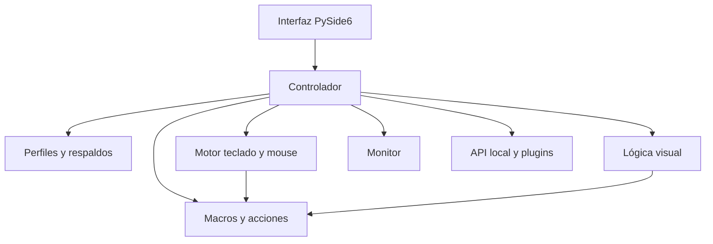

# Arquitectura

Ibiki Key separa los perfiles de los motores de entrada y de la interfaz.

- `models.py`: formato estable de perfiles, macros y grafos.
- `storage.py`: guardado atómico, perfiles `.ibiki`, macros `.ibikimacro` y respaldos.
- `engines/`: entrada global, macros, condiciones, API y plugins.
- `ui/`: páginas, diálogos, teclado visual y lienzo de nodos.
- `services/windows.py`: funciones exclusivas de Windows aisladas del resto.
- `services/mouse_backend.py`: hook y emisión de eventos de mouse mediante la API nativa de Windows, sin paquetes externos.
- `services/mouse_recording.py`: conversión comprobable de eventos nativos a pasos relativos y muestreados de macro.
- `services/logic_history.py`: historial acotado de grafos con restauración en el mismo objeto para mantener referencias de interfaz y motor.

El lienzo conserva en el modelo solamente nodos, conexiones y posiciones. Las macros agregan un campo opcional `scope`; al faltar se interpreta como `general`. El Dashboard 0.4 consume esos mismos modelos y el bus de eventos sin guardar datos visuales adicionales. Por eso se mantiene el esquema 1 y se abren perfiles anteriores sin reescritura destructiva.

Esta separación permite reemplazar el motor de hooks por un controlador por dispositivo sin romper perfiles ni la interfaz.
